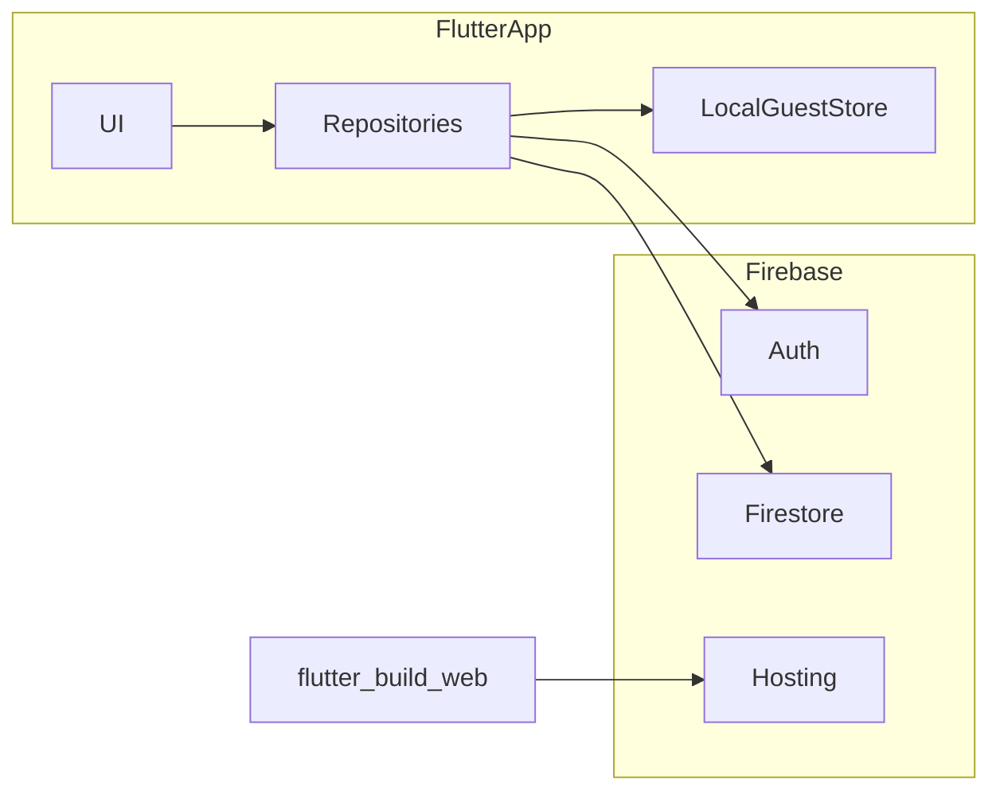

# Architecture

## Overview

- **Client**: Single **Flutter** application (targets **iOS**, **Android**, **Web**) located under [mobile/](mobile/).
- **Backend (v1)**: **Firebase** — Authentication, Cloud Firestore, and Firebase Hosting for the web build.
- **No separate Ruby or custom app server in v1** unless [PRODUCT.md](PRODUCT.md) is updated to require one.

## High-level flows

### Guest

1. App loads catalog from Firestore (read-only) or from a cached snapshot when offline (behavior TBD in implementation).
2. User records wins **locally** (including run result data: wins/perfect/tier) and can attach one local screenshot.
3. Search/filter/sort is available as MVP; **Challenges** checklist progress is computed on-device from local wins + catalog (same for guests).

### Signed-in user

1. User authenticates via Firebase Auth (email/password, Google, or Apple).
2. Runs are stored under that user’s identity in Firestore (see [DATA_MODEL.md](DATA_MODEL.md)).
3. One-time migration merges local guest wins after sign-in.
4. Near-duplicate merge candidates are surfaced in a post-scan review queue for bulk user resolution.
5. Search/filter/sort and Challenges progress remain client-derived from synced runs + catalog.

### Web vs mobile

- **Same codebase**; avoid `kIsWeb` branches except for documented reasons. Two
  documented exceptions exist:
  1. `AuthService.signInWithGoogle` branches on `kIsWeb` to use `signInWithPopup` on
     web vs. native `GoogleSignIn.authenticate()` on mobile — a genuine platform API
     difference.
  2. `ResponsiveShell` picks between `AppShellPage` (existing mobile chrome: bottom
     `NavigationBar` + FAB, unchanged) and `WebShellPage` (web-conventional chrome: top
     nav/side rail) based on a **width breakpoint** (`MediaQuery` width, currently
     900px), not `kIsWeb`. This is deliberate: a wide tablet should get the web-style
     shell and a narrow desktop browser window should still get the mobile-style shell.
     Both shells consume the same `SessionController` tab/account-intent contract via a
     shared mixin (`ShellTabIntentMixin`) so navigation-intent ownership stays singular
     per [AI_CODING.md](AI_CODING.md) — neither shell duplicates the other's
     tab-reset/account-open logic. All page *content* (Runs list, Catalog, Challenges,
     Account, Build input) is shared unmodified between shells; only the navigation
     chrome differs.
- **Routing**: `go_router` provides real URL routes (`/runs`, `/catalog`,
  `/catalog/:itemId`, `/challenges`, `/login`, `/account`) so the web build has
  shareable/bookmarkable links and working browser back/forward. Auth gating remains a
  widget wrapper (`AuthGate`), not a `go_router` redirect, since guests already reach
  every tab today — there is no auth-based route blocking to express. `RunDetailPage`
  and `ChallengeDetailPage` are not URL-addressable yet (they take live objects rather
  than ids); this is a deliberate scope cut, not an oversight.
- Feature parity is a **goal**; any intentional gap must be listed in [PRODUCT.md](PRODUCT.md).
- For delivery priorities, use [PRODUCT.md](PRODUCT.md) as source of truth.

## Repository layout (expected evolution)

Not prescriptive until implementation starts; typical shape:

- `lib/` — features (catalog, wins, auth, settings), shared widgets.
- `lib/data/` — Firestore/local adapters, DTOs.
- Optional `lib/domain/` — pure models and “won / not won” logic.

Package name may remain `mobile` until renamed in `pubspec.yaml`; coordinate renames in one pass.

## Open technical decisions

- **State management**: TBD — see [AI_CODING.md](AI_CODING.md).
- **Offline behavior**: How much catalog and win data is available offline for guests vs signed-in users — confirm when implementing.
